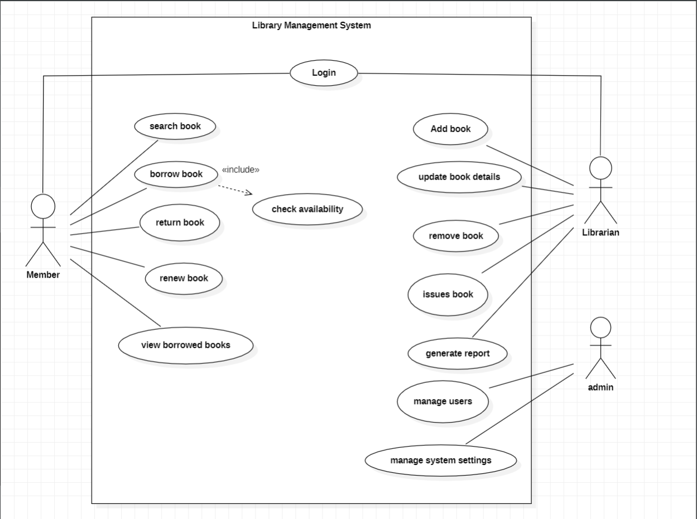
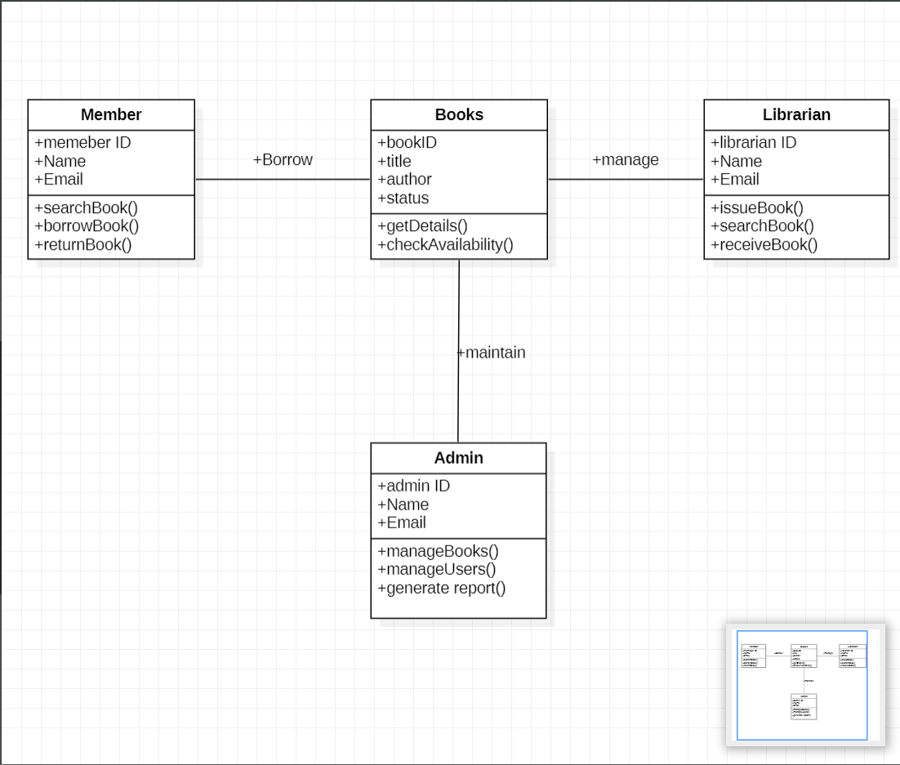
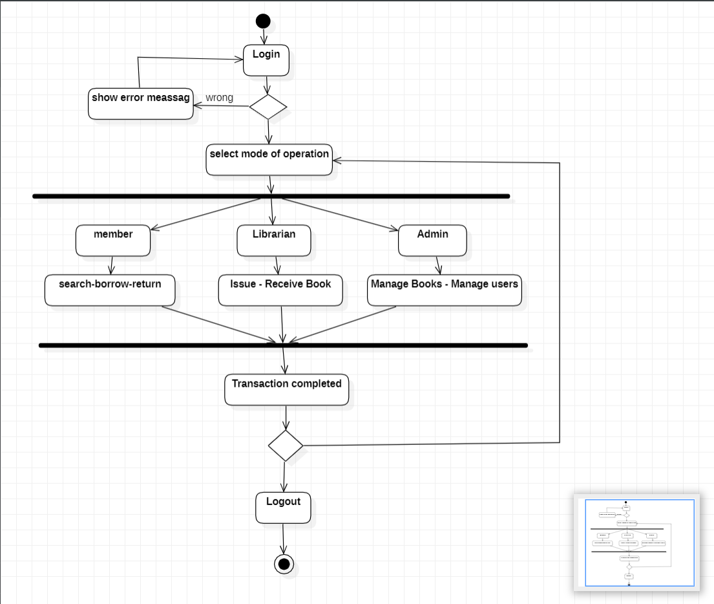
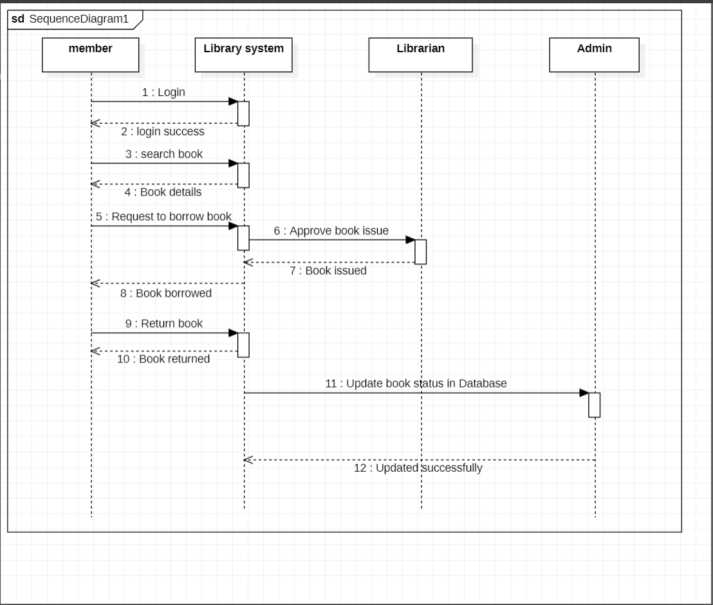
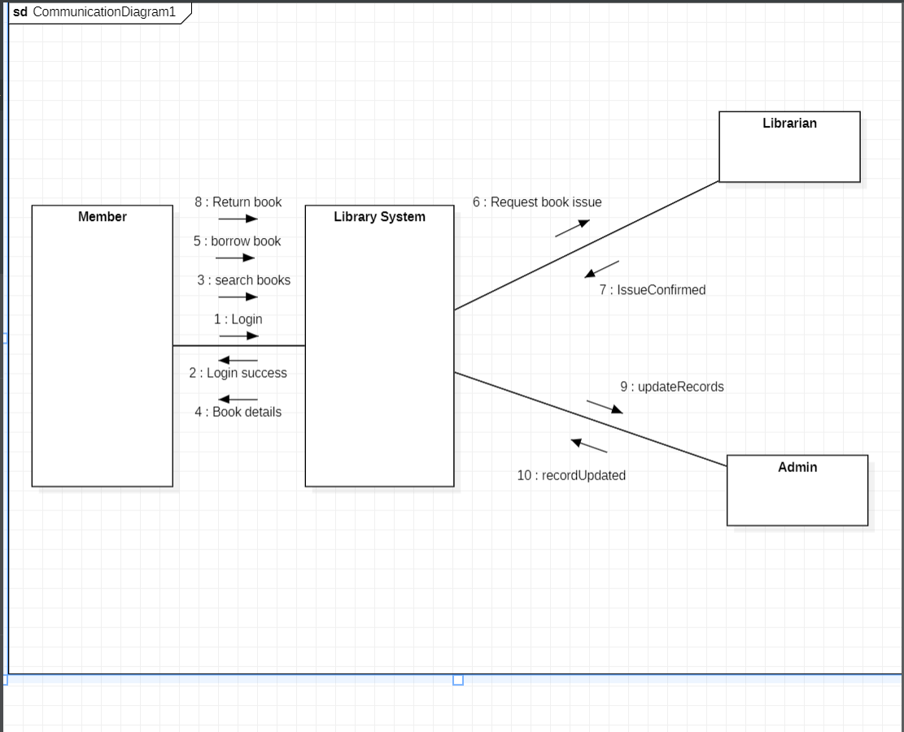
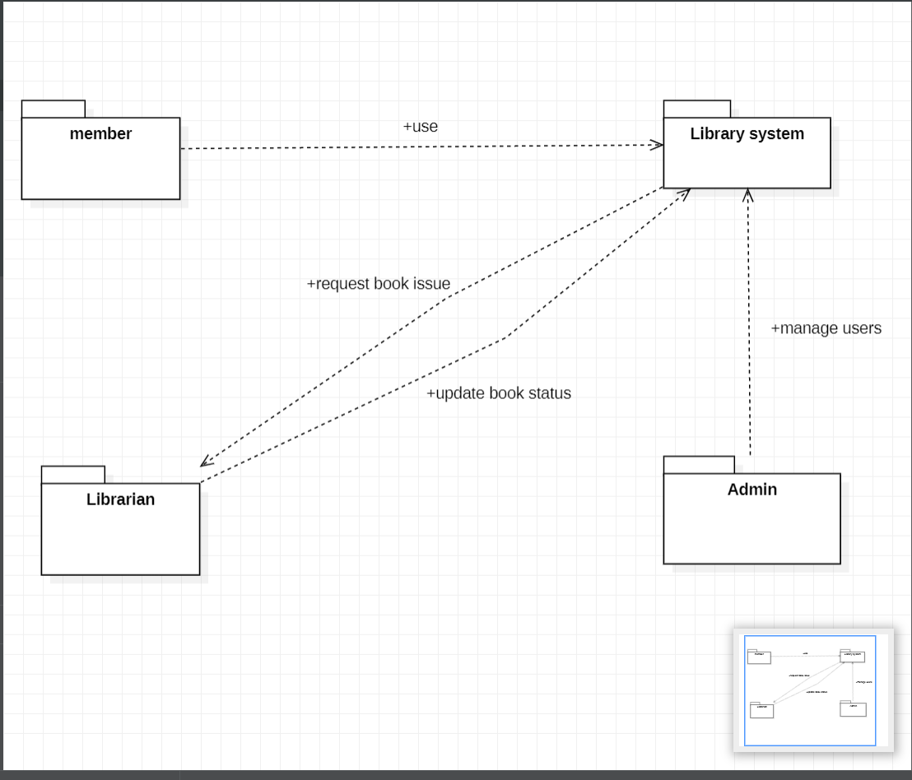

# EXP – 2: LIBRARY MANAGEMENT SYSTEM

# AIM:
To design and develop UML diagrams for a Library Management System to represent its structure, functions, and interactions between the member, librarian, and admin.

# SRS (Procedure):

## Step 1: Problem Identification
The main problem is the difficulty of manually managing library books, member records, book borrowing, and returns. A Library Management System helps automate these activities efficiently.

## Step 2: Requirement Analysis
Identify the main users: Member, Librarian, and Admin.

**Functional Requirements:**
1. Member login and book searching.
2. Check book availability.
3. Borrow and return books.
4. Librarian manages book issuing and returns.
5. Admin manages members and library records.
6. Generate library reports.

**Non-Functional Requirements:**
1. Security
2. Reliability
3. Accuracy
4. User-friendliness
5. Fast response time

## Step 3: System Design
Draw the following UML diagrams to represent the system:
1. Use Case Diagram
2. Class Diagram
3. Activity Diagram
4. Sequence Diagram
5. Communication Diagram
6. Package Diagram

# DIAGRAMS:

## Use Case Diagram

## Class Diagram

## Activity Diagram

## Sequence Diagram

## Communication Diagram

## Package Diagram

# RESULT:
Thus, the six UML diagrams for the Library Management System were designed successfully to represent its structure, functionality, and interactions between the member, librarian, and admin.
